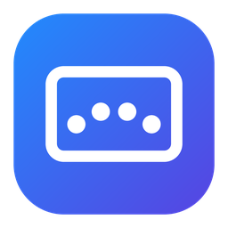

<p align="center">
  
</p>

<h1 align="center">TrackPad For Windows</h1>

<p align="center">
  Mac-style multi-finger gestures and a radial menu for Windows laptop touchpads.<br>
  <a href="README.tr.md">Türkçe</a>
</p>

---

## Features

- **4-finger tap → radial menu** around the cursor. The slice under the cursor grows and takes your Windows accent color.
- **Default menu:** Screenshot (top), Lock (right), Show desktop (bottom), Media (left).
- **Media card:** album art, title, artist, progress bar (click to seek), previous / play-pause / next and ±10 s buttons. Works with any player that reports to Windows (Spotify, browsers, Media Player…).
- **4-finger swipes:** down = show desktop, up = Task View, left / right = switch virtual desktop.
- **Settings window:** choose how many slices the menu has (2–8) and drag parts from the left onto the menu. Drag between slices to swap, right-click to clear.
- Follows the Windows light/dark theme and accent color.
- Runs in the tray, no admin rights, no internet connection, no telemetry.

## Requirements

- Windows 10 (version 1809 or later) or Windows 11, 64-bit (x64)
- A **Precision Touchpad** (Settings > Bluetooth & devices > Touchpad shows "Your PC has a precision touchpad")

## Installation

1. Download `TrackPadForWindows-win-x64.zip` from [Releases](../../releases) and extract it to a folder (for example `C:\Users\<you>\Apps\TrackPadForWindows`).
2. **Turn off the Windows 4-finger gestures** so they don't run twice: Settings > Bluetooth & devices > Touchpad > Four-finger gestures > set **Swipes** and **Taps** to **Nothing**.
3. Run `TrackPadForWindows.exe`. An icon appears next to the clock.
4. To start it with Windows: right-click the icon > **Windows ile başlat** (Start with Windows).

The app is not code-signed yet, so Windows SmartScreen may say "Windows protected your PC". Click **More info > Run anyway**. You can also build it yourself from this source code (see below).

## Usage

| Gesture | Action |
|---|---|
| 4-finger tap | Open the radial menu |
| 4-finger swipe down | Show desktop |
| 4-finger swipe up | Task View |
| 4-finger swipe left / right | Next / previous virtual desktop |

In the radial menu: click a slice to run it. Click the center, press Esc or click outside to close.

**Tray icon:** left-click opens the menu, double-click opens Settings, right-click shows the options.

If the menu doesn't open, hover over the tray icon: it shows how many fingers were detected on the last touch.

## Customizing

Open **Settings** from the tray icon and drag parts into the menu. Advanced options (gestures, timings, custom commands) are in `%APPDATA%\TrackPadForWindows\menu.json`. After editing, right-click the tray icon > **Ayarları yeniden yükle** (Reload settings).

```jsonc
{
  "maxTapMs": 350,        // a tap may last at most this many ms
  "maxMove": 0.05,        // fingers may move at most 5% of the pad during a tap
  "swipeDistance": 0.12,  // fingers must move 12% of the pad for a swipe
  "taps":   [ { "fingers": 4, "action": { "type": "menu" } } ],
  "swipes": [ { "fingers": 4, "direction": "down", "action": { "type": "keys", "keys": "Win+D" } } ],
  "menu": [
    { "type": "keys",  "label": "Screenshot", "icon": "E722", "keys": "Win+Shift+S" },
    { "type": "run",   "label": "Notepad",    "icon": "E70B", "target": "notepad.exe" },
    { "type": "media", "label": "Media",      "icon": "E8D6" }
  ]
}
```

| type | What it does | Fields |
|---|---|---|
| `menu` | Opens the radial menu (in `taps` / `swipes`) | |
| `media` | Opens the media card | |
| `keys` | Sends a key combination to the window that was active | `keys` (e.g. `Ctrl+Shift+Esc`, `Win+D`, `MediaPlayPause`) |
| `run` | Opens a program, folder, file, URL or `ms-settings:` page | `target`, `args` |
| (with `items`) | Sub-menu | `label`, `items` |

`icon` is a [Segoe Fluent Icons](https://learn.microsoft.com/windows/apps/design/style/segoe-fluent-icons-font) code point such as `E722`.

## Security and privacy

- Reads only the touchpad (HID Digitizer / Touch Pad) through the Windows Raw Input API. It does not read the keyboard and installs no hooks.
- Sends a key combination only when you choose a `keys` action.
- Makes no network connections. Settings stay in `%APPDATA%\TrackPadForWindows`.
- Needs no administrator rights. The only registry write is the optional "Start with Windows" entry under `HKCU\...\Run`.
- Ships as a normal, uncompressed .NET application folder. Every release is built from this repository by GitHub Actions.

## Building from source

Install the [.NET 8 SDK](https://dotnet.microsoft.com/download/dotnet/8.0) and run `build.bat`, or:

```
dotnet publish src/TrackPadForWindows -c Release -r win-x64 --self-contained true -o publish/TrackPadForWindows
```

## How it works

The app registers for Raw Input from Precision Touchpads (`RIDEV_INPUTSINK`, so it works in the background) and parses the HID reports with `HidP_*` functions: contact count, contact ID, tip switch and X/Y per finger. A short, still touch counts as a tap. When all fingers move together past a threshold, it counts as a swipe. The media card uses the Windows `GlobalSystemMediaTransportControlsSessionManager` API.

## License

[MIT](LICENSE). See also [SECURITY.md](SECURITY.md).
