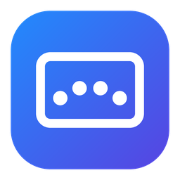

<p align="center">
  
</p>

<h1 align="center">TrackPad For Windows</h1>

<p align="center">
  Windows dizüstü touchpad'leri için Mac tarzı çok parmaklı hareketler ve yuvarlak menü.<br>
  <a href="README.md">English</a>
</p>

---

## Özellikler

- **4 parmakla dokunma:** imlecin etrafında yuvarlak bir menü açılır. İmlecin üzerindeki dilim büyür ve Windows vurgu renginizi alır.
- **Varsayılan menü:** Ekran görüntüsü (üst), Kilitle (sağ), Masaüstü (alt), Medya (sol).
- **Medya kartı:** kapak resmi, şarkı adı, sanatçı, ilerleme çubuğu (tıklayarak sarılır), önceki / oynat-duraklat / sonraki ve ±10 sn düğmeleri. Windows'a çalan bilgisini veren her oynatıcıyla çalışır (Spotify, tarayıcılar, Medya Oynatıcı...).
- **4 parmakla kaydırma:** aşağı = masaüstü, yukarı = görev görünümü, sola / sağa = sanal masaüstü değiştirme.
- **Ayarlar penceresi:** menünün kaç dilimli olacağını seçin (2–8) ve soldaki parçaları menüye sürükleyin. Dilimler arasında sürükleyerek yer değiştirin, sağ tıklayarak boşaltın.
- Windows'un açık/koyu temasına ve vurgu rengine uyar.
- Sistem tepsisinde çalışır. Yönetici izni ve internet bağlantısı gerektirmez, veri toplamaz.

## Gereksinimler

- Windows 10 (1809 veya sonrası) ya da Windows 11, 64 bit (x64)
- **Precision Touchpad** (Ayarlar > Bluetooth ve cihazlar > Dokunmatik yüzey bölümünde "Bilgisayarınızda hassas dokunmatik yüzey var" yazmalı)

## Kurulum

1. [Releases](../../releases) sayfasından `TrackPadForWindows-win-x64.zip` dosyasını indirip bir klasöre çıkarın (ör. `C:\Users\<siz>\Apps\TrackPadForWindows`).
2. Hareketler iki kez çalışmasın diye **Windows'un 4 parmak hareketlerini kapatın:** Ayarlar > Bluetooth ve cihazlar > Dokunmatik yüzey > Dört parmakla hareketler bölümünde **Kaydırmalar** ve **Dokunmalar** ayarlarını **Hiçbir şey** yapın.
3. `TrackPadForWindows.exe` dosyasını çalıştırın. Saatin yanında bir simge belirir.
4. Windows ile birlikte açılması için simgeye sağ tıklayıp **Windows ile başlat** seçeneğini işaretleyin.

Program henüz kod imzalı değil, bu yüzden Windows SmartScreen "Windows bilgisayarınızı korudu" uyarısı verebilir. **Ek bilgi > Yine de çalıştır** seçeneğine tıklayın. İsterseniz programı bu kaynak koddan kendiniz de derleyebilirsiniz (aşağıya bakın).

## Kullanım

| Hareket | Ne yapar |
|---|---|
| 4 parmakla dokunma | Yuvarlak menüyü açar |
| 4 parmakla aşağı kaydırma | Masaüstünü gösterir |
| 4 parmakla yukarı kaydırma | Görev görünümünü açar |
| 4 parmakla sola / sağa kaydırma | Sonraki / önceki sanal masaüstüne geçer |

Yuvarlak menüde bir dilime tıklayınca o işlem çalışır. Menüyü kapatmak için ortaya tıklayın, Esc'ye basın ya da menünün dışına tıklayın.

**Sistem tepsisi simgesi:** sol tık menüyü, çift tık Ayarlar'ı açar. Sağ tık seçenekleri gösterir.

Menü açılmıyorsa imleci simgenin üzerine getirin. Son dokunuşta kaç parmak algılandığı orada görünür.

## Özelleştirme

Simgeden **Ayarlar**'ı açıp parçaları menüye sürükleyin. Gelişmiş ayarlar (hareketler, süreler, özel komutlar) `%APPDATA%\TrackPadForWindows\menu.json` dosyasındadır. Dosyayı düzenledikten sonra simgeye sağ tıklayıp **Ayarları yeniden yükle** seçeneğine tıklayın.

```jsonc
{
  "maxTapMs": 350,        // dokunuş en fazla bu kadar ms sürebilir
  "maxMove": 0.05,        // dokunurken parmaklar yüzeyin en fazla %5'i kadar kayabilir
  "swipeDistance": 0.12,  // kaydırma sayılması için yüzeyin %12'si kadar kayma gerekir
  "taps":   [ { "fingers": 4, "action": { "type": "menu" } } ],
  "swipes": [ { "fingers": 4, "direction": "down", "action": { "type": "keys", "keys": "Win+D" } } ],
  "menu": [
    { "type": "keys",  "label": "Ekran görüntüsü", "icon": "E722", "keys": "Win+Shift+S" },
    { "type": "run",   "label": "Not Defteri",     "icon": "E70B", "target": "notepad.exe" },
    { "type": "media", "label": "Medya",           "icon": "E8D6" }
  ]
}
```

| type | Ne yapar | Alanlar |
|---|---|---|
| `menu` | Yuvarlak menüyü açar (`taps` / `swipes` içinde) | |
| `media` | Medya kartını açar | |
| `keys` | Menü açılmadan önce etkin olan pencereye tuş kombinasyonu gönderir | `keys` (ör. `Ctrl+Shift+Esc`, `Win+D`, `MediaPlayPause`) |
| `run` | Program, klasör, dosya, web adresi ya da `ms-settings:` sayfası açar | `target`, `args` |
| (`items` verilirse) | Alt menü | `label`, `items` |

`icon` alanı, `E722` gibi bir [Segoe Fluent Icons](https://learn.microsoft.com/windows/apps/design/style/segoe-fluent-icons-font) kodudur.

## Güvenlik ve gizlilik

- Windows Raw Input API ile yalnızca touchpad'i (HID Digitizer / Touch Pad) okur. Klavyeyi okumaz, hook kurmaz.
- Tuş kombinasyonunu yalnızca siz bir `keys` işlemi seçtiğinizde gönderir.
- İnternete bağlanmaz. Ayarlar `%APPDATA%\TrackPadForWindows` klasöründe kalır.
- Yönetici izni gerektirmez. Kayıt defterine yazdığı tek şey, isteğe bağlı "Windows ile başlat" kaydıdır (`HKCU\...\Run`).
- Sıkıştırılmamış, normal bir .NET uygulama klasörü olarak dağıtılır. Her sürüm GitHub Actions ile bu depodan derlenir.

## Kaynaktan derleme

[.NET 8 SDK](https://dotnet.microsoft.com/download/dotnet/8.0) kurup `build.bat` dosyasını çalıştırın ya da şu komutu kullanın:

```
dotnet publish src/TrackPadForWindows -c Release -r win-x64 --self-contained true -o publish/TrackPadForWindows
```

## Nasıl çalışır

Program, Precision Touchpad'lerden Raw Input almak için kayıt olur (`RIDEV_INPUTSINK` sayesinde arka planda da çalışır). HID raporlarını `HidP_*` fonksiyonlarıyla çözer: temas sayısı, temas kimliği, tip switch ve her parmağın X/Y konumu. Kısa ve hareketsiz bir dokunuş "tap" sayılır. Parmakların hepsi birlikte belli bir mesafeyi geçince hareket "kaydırma" sayılır. Medya kartı, Windows'un `GlobalSystemMediaTransportControlsSessionManager` API'sini kullanır.

## Lisans

[MIT](LICENSE). Ayrıca bkz. [SECURITY.md](SECURITY.md).
